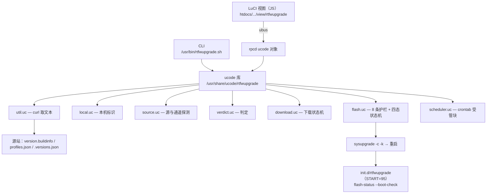
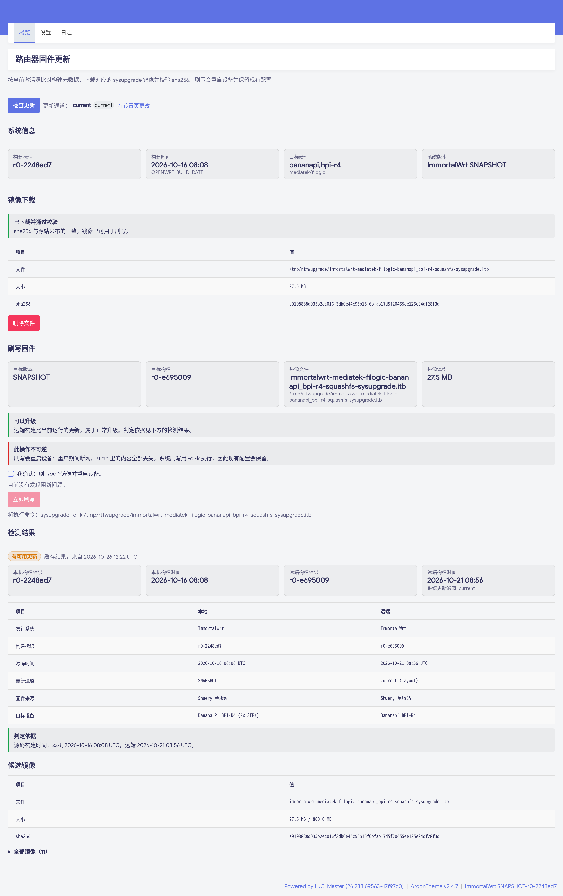
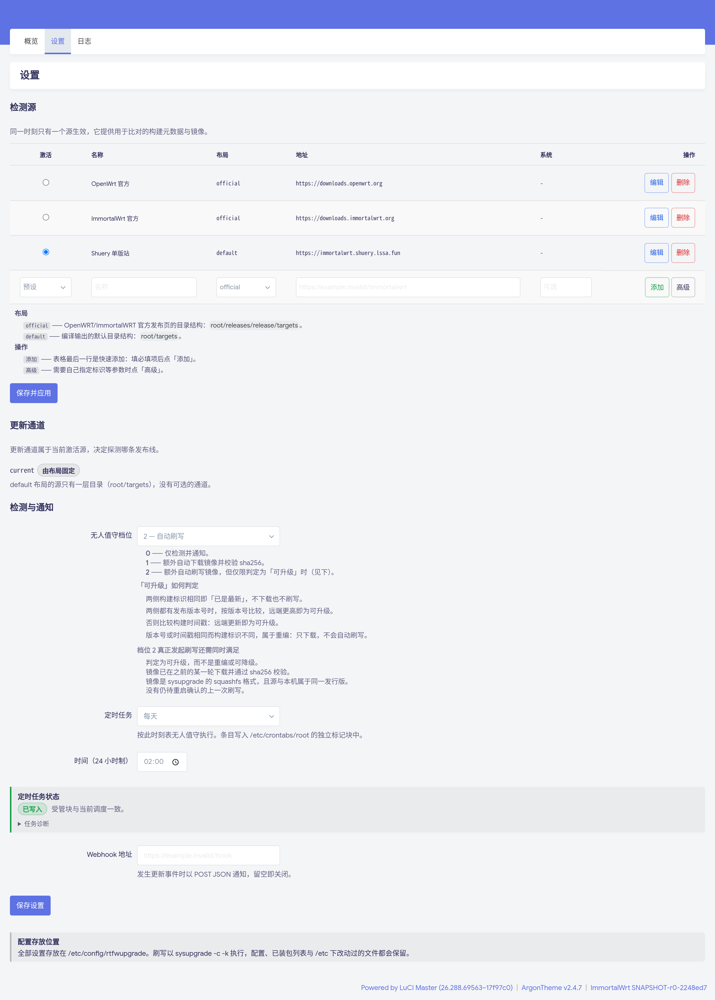
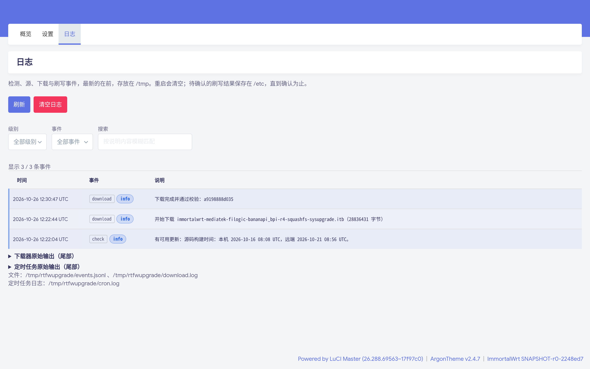
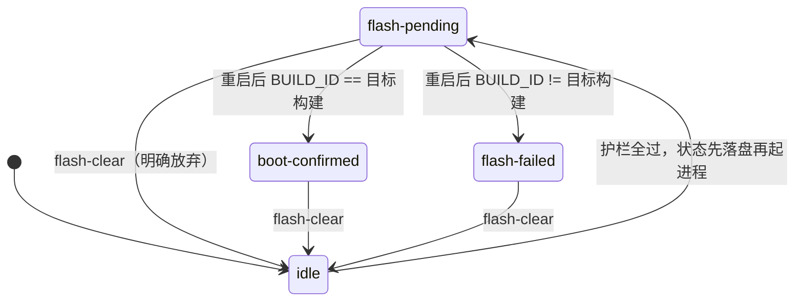

# LuciRtfwUpgrade

**在路由器上把「固件更新」这件事做完 —— 检测、下载、校验、刷写、结果确认，全程在 LuCI 中操作。**

[](https://github.com/Shuery-Shuai/LuciSysUpgrade/actions/workflows/ci.yml)
[](https://github.com/Shuery-Shuai/LuciSysUpgrade/releases)
[](LICENSE)
[](https://openwrt.org)
[](https://downloads.immortalwrt.org)
[](https://ucode.mein.io)

OpenWrt / ImmortalWrt 的 LuCI 固件更新应用。读取本机构建标识后，与你配置的发布源比对，
给出「有更新 / 已是最新 / 远端更旧 / 同版本不同构建 / 无法比较」；镜像下载到 `/tmp` 并按源站公布的
`sha256` 校验；通过 **8 条阻断护栏**后才用 `sysupgrade -c -k` 刷写；设备重启后由**开机闭环**自证结果。

> [!WARNING]
>
> 刷写会重启设备。默认档位下**必须人工确认**（`flash` 只报告，加 `--yes` 才动手）；
> 只有把无人值守档位设为 `2` 且本次判定恰好是 `update` 时才会自动刷写。
>
> 只支持 **sysupgrade + squashfs** 镜像。factory 镜像会重写引导链或分区表，本项目一律不支持。

<!-- 与上方 WARNING 分开，避免两个 alert 被渲染成同一个引用块 -->

> [!NOTE]
>
> 仓库名仍是历史留下的 `LuciSysUpgrade`，但项目名与包内标识统一为 **`rtfwupgrade`**。
> ucode 的 `require()` 不接受连字符，因此内部名写成一个词；包名、CLI、菜单则可以带连字符。

## 目录

- [✨ 特性](#-特性)
- [🧭 设计取舍：为什么不看发布时间](#-设计取舍为什么不看发布时间)
- [🏗 架构](#-架构)
- [🚀 快速开始](#-快速开始)
- [🖼 界面预览](#-界面预览)
- [🛠 使用](#-使用)
- [⚙ 配置](#-配置)
- [🔍 检测源与更新通道](#-检测源与更新通道)
- [🔥 刷写](#-刷写)
- [🔔 定时任务与通知](#-定时任务与通知)
- [🧪 测试](#-测试)
- [📦 仓库结构](#-仓库结构)
- [📚 文档](#-文档)
- [🤝 贡献](#-贡献)
- [📄 许可证](#-许可证)

## ✨ 特性

- 🔍 **检测**：多源管理；更新通道默认「当前通道」，也可按源另行指定；按 `board_name` 在
  `profiles.json` 的 `supported_devices` 里自动匹配 profile，再从 `images[]` 挑出
  `sysupgrade` + `squashfs` 候选。
- ⬇️ **下载**：`curl -C -` 续传；续传前必须 `ETag` **与** `Last-Modified` 双双一致，否则删残片重下；
  下载前就按 `file_size_limits.image` 拒绝超大镜像；取消按**进程组**杀，不留孤儿 curl。
- ✅ **校验**：按源站 `profiles.json` 公布的 `sha256` + 体积双重核对。
- 🔥 **刷写**：命令恒为 `sysupgrade -c -k <绝对路径>`（保留配置 + 已装包列表），8 条护栏全过才发起。
- ♻️ **闭环**：`flash-pending → boot-confirmed / flash-failed`，四态状态机在重启后依然有效；读到非法值时一律当 `idle` 处理。
- 🕒 **定时**：调度写进 `/etc/crontabs/root` 的**受管标记块**，不会改动块外内容（nginx-util、acme 等）。
- 🔔 **通知**：通用 webhook（POST JSON），检测/下载/刷写共六类事件，未配置时静默跳过。
- 🌐 **界面**：LuCI「系统 → 路由器固件更新」三页（概览 / 设置 / 日志），i18n 跟随官方 `po/` 机制。
- 🚫 **不碰非官方字段**：不读 HTTP `Last-Modified`、不读文件 mtime、不解析文件名里的日期。

## 🧭 设计取舍：为什么不看发布时间

| 用途                 | 本机字段                                      | 远端字段                               |
| -------------------- | --------------------------------------------- | -------------------------------------- |
| 身份（是否同一构建） | `/usr/lib/os-release` → `BUILD_ID`            | `<dir>/version.buildinfo`              |
| 方向（谁更新）       | `OPENWRT_BUILD_DATE`（= `SOURCE_DATE_EPOCH`） | `profiles.json` → `source_date_epoch`  |
| 方向（发行版通道）   | `VERSION`（如 `25.12.2`）                     | `profiles.json` → `version_number`     |
| 通道发现             | —                                             | 根 `/.versions.json`（官方格式，可选） |

**实测反例**：`rtfw.shuery.lssa.fun` 的 immortalwrt 快照发布于 2026-10-02（看上去最新），
但其源码是上游 2026-07-06 的提交，而设备跑的是 2026-09-29 的源码 —— 按发布时间判定会**推荐用户降级**。
所以方向只由「源码时间戳」与「发行版版本号」决定，契约细节见
[docs/SOURCE-CONTRACT.md](docs/SOURCE-CONTRACT.md)。

判定结果恰好五个取值：

| state          | 含义               | 触发条件                           |
| -------------- | ------------------ | ---------------------------------- |
| `same`         | 已是最新           | 两侧构建标识相同                   |
| `update`       | 有可用更新         | 远端版本更高 / 远端源码更新        |
| `downgrade`    | 远端更旧（可降级） | 远端版本更低 / 远端源码更旧        |
| `rebuild`      | 同版本、不同构建   | 版本号或源码时间相同但构建标识不同 |
| `incomparable` | 无法比较           | 探测失败或缺少可比字段             |

## 🏗 架构

前端只通过 rpcd 的 ubus 对象 `rtfwupgrade` 访问后端（ACL：`ubus.rtfwupgrade.*` + `uci.rtfwupgrade`），
不在前端拼接命令，也不给它任意文件读写权限。CLI 与 rpcd 共用同一套 ucode 库。



开机闭环是一条**不经过前端**的路径：`/etc/init.d/rtfwupgrade` → `rtfwupgrade.sh flash-status --boot-check`
→ `flash.boot_check()`，结果写回状态文件并投递刷写 webhook。因此即使 LuCI 没打开、rpcd 被重启，
这次刷写的结果也一定会被记录下来。

## 🚀 快速开始

### 环境要求

- OpenWrt **24.10** 或 **25.12 / main**（ImmortalWrt 同样适用）
- 已装 LuCI（`luci-base`）
- 已安装 `curl`、`ucode` 及 `ucode-mod-digest`（包依赖里已声明，装包时会自动带上）

### 安装（推荐：直接用 Release 产物）

到 [Releases](https://github.com/Shuery-Shuai/LuciSysUpgrade/releases/latest) 下载对应格式的包：
25.12 / main 用 apk，24.10 用 opkg，二者由 CI 的 SDK 矩阵分别构建。

```sh
# 25.12 / main（apk-tools）
apk add --allow-untrusted ./luci-app-rtfwupgrade-0.2.0_alpha2-r1.apk

# 24.10（opkg）
opkg install ./luci-app-rtfwupgrade_0.2.0_alpha2-r1_all.ipk
```

中文界面需额外装语言包（主包只含代码与配置，`.lmo` 由官方机制单独打包）：

```sh
apk add --allow-untrusted ./luci-i18n-rtfwupgrade-zh-cn-0.apk
# 或
opkg install ./luci-i18n-rtfwupgrade-zh-cn_0_all.ipk
```

装完刷新一次 LuCI，入口在 **系统 → 路由器固件更新**（英文菜单 **Router Firmware Update**）。

### 从源码编译（SDK）

```sh
# SDK 内
./scripts/feeds update -a && ./scripts/feeds install -a
cp -r luci-app-rtfwupgrade package/
make package/luci-app-rtfwupgrade/compile V=s
```

产物：`bin/packages/*/base/luci-app-rtfwupgrade_*.{ipk,apk}`，外加每个语言目录对应的
`luci-i18n-rtfwupgrade-<lang>` 语言包（24.10 SDK → ipk；25.12 / main SDK → apk）。
必须 `feeds install -a`：`po2lmo` 由 `luci-base` 构建，而它依赖 packages feed 的 `liblua`。

> [!TIP]
>
> 想在推送 CI 之前先本地验证打包，可以跑 `tools/build-local.sh`：它在 Docker 里用两份官方 SDK
> 复现 CI 的构建矩阵，产物再由 `tools/inspect-package.py` 离线核对（主包不得包含 `.lmo`）。

## 🖼 界面预览

三页都在 **系统 → 路由器固件更新** 下。截图取自一台 Banana Pi BPI-R4（ImmortalWrt SNAPSHOT，
已检测到可用更新且镜像已下载校验）：左侧是概览，右上为设置，右下为日志。

<!-- 用 table 而非浮动 div：GitHub 的 HTML 白名单里没有 float/position/class/style，
     只有 table/td 的 width、valign 这类属性还能表达两栏布局，且必须在 GitHub 上不塌。 -->

<table>
  <tr>
    <td width="60%" valign="top">
      <b>概览</b><br/>
      检测结论、候选镜像、下载状态与刷写入口。
      <a href="docs/assets/overview.png"></a>
    </td>
    <td width="40%" valign="top">
      <b>设置</b><br/>
      检测源表格（含预设）、更新通道、无人值守档位与定时任务。
      <a href="docs/assets/settings.png"></a>
      <b>日志</b><br/>
      检测、源、设置与下载事件，最新在前，可按级别与内容筛选。
      <a href="docs/assets/logs.png"></a>
    </td>
  </tr>
</table>

<!-- 与下方 NOTE 分开，避免两个 alert 被渲染成同一个引用块 -->

> [!NOTE]
>
> 截图只截取了内容区，左侧导航栏是 Argon 主题自带的，与本应用无关。
> 点击图片可查看原图。

## 🛠 使用

命令行入口 `/usr/bin/rtfwupgrade.sh` 实际上是一个 **ucode 脚本**（shebang 为 `/usr/bin/env ucode`），
`.sh` 只是项目约定的文件名，**不要**用 `sh rtfwupgrade.sh` 去启动它。

```sh
rtfwupgrade.sh status         # 本机标识 + 最近一次检测结果
rtfwupgrade.sh sources        # 已配置的源与激活源
rtfwupgrade.sh check          # 检测（激活源）
rtfwupgrade.sh check --source openwrt --json
rtfwupgrade.sh check --channel stable             # 仅本次指定通道，不改写配置
rtfwupgrade.sh flash          # 刷写检查：打印 8 条护栏与将要执行的命令，不刷写
rtfwupgrade.sh flash --yes    # 护栏全部通过才真正刷写（设备随后重启）
rtfwupgrade.sh flash-status   # 刷写状态（idle / flash-pending / boot-confirmed / flash-failed）
rtfwupgrade.sh flash-clear    # 放弃一笔未确认的刷写，状态回到 idle
rtfwupgrade.sh cron           # 定时任务入口（crontab 调用的就是它）
rtfwupgrade.sh schedule       # 查看调度与实际 crontab 是否一致
rtfwupgrade.sh version        # 版本号
```

| 选项           | 适用范围                    | 说明                                                                                                        |
| -------------- | --------------------------- | ----------------------------------------------------------------------------------------------------------- |
| `--source`     | `check` / `flash` 等        | 仅本次生效，不会改写 `active_source`                                                                        |
| `--channel`    | `check` / `flash` 及下载    | 仅本次生效：可以是语义值（`snapshot`/`stable`/`oldstable`/`major`/`minor`），也可以是具体目录；不会改写配置 |
| `--json`       | 除 `version` 外的查询类命令 | 以 JSON 输出                                                                                                |
| `--apply`      | 仅 `schedule`               | 把调度写入 `/etc/crontabs/root`                                                                             |
| `--yes`        | 仅 `flash`                  | 护栏通过时真正刷写                                                                                          |
| `--force`      | 仅 `flash`                  | **仅**放行「跨发行版」与「跨源」两条护栏，其余 6 条仍然阻断                                                 |
| `--boot-check` | 仅 `flash-status`           | 开机自检：结案 `flash-pending` 并投递刷写 webhook                                                           |

加 `--yes` 才算「同意刷写」：不加时 `flash` 只做报告，退出码恒为 0；加了之后，若护栏阻断或
发起失败，退出码为 1。

### LuCI 界面

| 页面 | 作用                                                                                                                                                                                                                                                                                   |
| ---- | -------------------------------------------------------------------------------------------------------------------------------------------------------------------------------------------------------------------------------------------------------------------------------------- |
| 概览 | **更新通道只读展示**（当前通道及其解析出的目录，切换入口在设置页）+ 状态徽标 + 本机/远端对照 + 判定依据 + 候选镜像 + 下载（进度/取消/续传/删除）+ **刷写**（四态展示、目标四项核对、判定分级提示、跨源更换与跨发行版刷写各自的放行勾选、「我确认」勾选框、清除状态）+ 全部镜像折叠列表 |
| 设置 | **检测源**（表格内增删改、单选激活、预设一键套用；跨源换源需勾选放行）、**更新通道**（各通道的含义与取数策略，切换前弹窗说明后果）与**检测通知**（无人值守档位及其判定规则、定时任务、crontab 同步状态、webhook）                                                                      |
| 日志 | 检测/源/设置/下载事件（最新在前），支持按级别、事件类型与内容模糊筛选；另有下载器与 cron 输出尾部；可刷新与清空                                                                                                                                                                        |

> [!IMPORTANT]
>
> **跨源更换**与**跨发行版刷写**是两回事，不要混在一起看。前者比较的是「这次要用的源与用户确认过的源」，
> 后者比较的是「探测到的源与本机发行版」。两者**在后端都会被拦下**（h 条与 f 条），界面上的提示只是提前告知。
>
> 两者的放行条件不同：跨发行版可以用 `--force`，也可以依赖持久配置 `flash_allow_cross_distro`；
> 跨源**只认当场的 `--force`**。那个持久开关的含义是「我接受更换发行版」，不应该顺带替用户确认一个
> 他从未确认过的固件来源。在无人值守路径（cron 档位 2）上，两者一律不放行。

## ⚙ 配置

配置文件 `/etc/config/rtfwupgrade`（conffile，升级时保留）：

| 选项                       | 取值                                   | 默认      | 说明                                                                 |
| -------------------------- | -------------------------------------- | --------- | -------------------------------------------------------------------- |
| `unattended`               | `0` / `1` / `2`                        | `0`       | 0 仅检测并通知；1 自动下载；2 自动下载并在判定为 `update` 时自动刷写 |
| `schedule_kind`            | `off` / `daily` / `weekly` / `monthly` | `daily`   | 定时检测频率                                                         |
| `schedule_time`            | `HH:MM`（24 小时制）                   | `04:00`   | 触发时间                                                             |
| `schedule_weekday`         | `1`（周一）… `7`（周日）               | `1`       | 仅 `weekly` 使用                                                     |
| `schedule_day`             | `1`–`28`                               | `1`       | 仅 `monthly` 使用；29–31 号在部分月份不触发，因此禁止                |
| `webhook`                  | URL 或空                               | 空        | 通用 POST JSON 通知，留空则关闭                                      |
| `active_source`            | 源标识                                 | `openwrt` | **同一时刻只有一条源激活**                                           |
| `current_firmware_source`  | 源标识或空                             | 空        | 用户**确认过**的固件来源；空表示尚未确认，概览页据此要求先确认再刷   |
| `flash_allow_cross_distro` | `0` / `1`                              | `0`       | 仅决定**手工**刷写是否默认放行跨发行版护栏；自动路径永远无视它       |

源段（`config source '<name>'`）另有 `channel` 选项，见[检测源与更新通道](#-检测源与更新通道)。
要区分 `active_source` 与 `current_firmware_source`：前者只要切换源就会变，后者只在首次确认、
或「放行跨源并真的发起刷写」时才更新。因此「已切换源但尚未确认」是一个可以辨认的状态。

无人值守档位的边界十分明确：**只有判定为 `update` 才会自动刷写**，`rebuild`（同版本、不同构建）只下载；
自动路径**从不使用 force**，所以跨发行版与跨源两条护栏在无人值守下都放不开 ——
定时任务不应该把设备刷成另一个发行版，也不应该从用户尚未认可的来源刷写。

## 🔍 检测源与更新通道

### 更新通道

通道**保存在每个源自己的配置里**，而不是一个全局开关：官方源同时有 `snapshots` 和多个 `releases/<ver>`，
单版本发布站（`default` 布局）只有一层 `targets` 目录 —— 做成全局开关，总会有源用不上这个控件。

| `channel` 取值   | 含义                                                                    |
| ---------------- | ----------------------------------------------------------------------- |
| 空（默认）       | **当前通道**：snapshot 本机看 `snapshots`，release 看同版本线的最新发布 |
| `snapshot`       | 快照通道 `snapshots`                                                    |
| `stable`         | 源公布 `stable_version` 对应的发布目录                                  |
| `oldstable`      | 源公布 `oldstable_version` 对应的发布目录                               |
| `major`          | 本机主版本（如 `25.x`）的最新发布版                                     |
| `minor`          | 本机子版本（如 `25.12.x`）的最新发布版                                  |
| `releases/<ver>` | 直接固定在某个具体版本目录（兼容旧配置）                                |

这里保存的是「跟随哪条线」这样的语义值，而不是某个会过期的具体版本号：`resolve_channel()` 每次探测
都根据源上的 `.versions.json` 现算目录，所以选了「稳定版」会跟着源一起前进。**判定逻辑不随通道改变** ——
通道只决定去哪个目录取数据，取回来一律走同一套 `probe()` 与 `verdict.compare()`，因此选 `stable`
得到 `downgrade` 是正确的结果。语义值解析不出来时（源上没有这条版本线，或本机是 SNAPSHOT、
没有版本号可用来解析主/子版本），`resolve_for_probe()` 会直接报错，**不会退回到别的通道** ——
退回会给出一个「来自你没选的通道」的结论。

<!-- 与上方通道说明分开，避免两个 alert 被渲染成同一个引用块 -->

> [!TIP]
>
> 概览页只**显示**当前通道（只读，附「在设置页更改」链接），要切换只能在设置页操作。
> 切换前会弹窗说明三件事：上次检测结果作废、跨通道的构建无法比较（可能出现「可降级」）、
> 定时任务与自动刷写也会改用新通道。`--channel` 只影响本次调用，不写入 UCI。
> `default` 布局的通道固定为 `current`，对这类源调用 `set_channel` 会被直接拒绝。

### 内置源与布局

内置**两条**默认源（都是 `official` 布局）：**OpenWrt 官方**与 **ImmortalWrt 官方**，
出厂配置里 `active_source` 指向 `openwrt`。设置页另外提供了 **4 个预设**，用来快速填好表单
（并不会自动创建源）：两条官方源、**RTFW 多发行版聚合站**（`official` 布局，用 `system` 段区分发行版）、
以及**单版本发布站**（`default` 布局，对应自建编译产物 `bin/targets` 里的原始镜像）。

| layout     | 结构                                                                                           | 路径模板                                                                      | 例子                                  |
| ---------- | ---------------------------------------------------------------------------------------------- | ----------------------------------------------------------------------------- | ------------------------------------- |
| `official` | OpenWRT/ImmortalWRT 官方发布页（`root/releases/<ver>/targets`，快照 `root/snapshots/targets`） | `<base>[/<system>]/{snapshots\|releases/<ver>}/targets/<target>/<subtarget>/` | `https://downloads.immortalwrt.org`   |
| `default`  | 默认编译输出目录（`root/targets`，即 `bin/targets` 裸镜像）                                    | `<base>[/<system>]/targets/<target>/<subtarget>/`                             | `https://immortalwrt.shuery.lssa.fun` |

<!-- 与上方 TIP 分开，避免两个 alert 被渲染成同一个引用块 -->

> [!IMPORTANT]
>
> 选到与本机**不同族**的源（例如设备跑 ImmortalWrt、源是 OpenWrt 官方）时，探测会给出跨发行版警告：
> 那属于「换系统」而不是升级，配置文件可能不兼容 —— 常见后果是刷完配置错乱。

校验规则：标识须匹配 `^[a-z0-9][a-z0-9_-]{0,31}$`、地址必须是 http(s)、布局须在白名单内。
删除当前激活的源时，回退结果会**真实写回 UCI**，不会留下一个指向已删源的 `active_source`；
最后一条源也不允许删除。源只有「存在」与「激活」两种状态，没有 `enabled` 这类中间状态。

## 🔥 刷写

命令只有一种形态：`sysupgrade -c -k <镜像绝对路径>`（不加 `-n`，即保留配置）。



| state            | 含义                                     |
| ---------------- | ---------------------------------------- |
| `idle`           | 没有状态文件                             |
| `flash-pending`  | 状态已落盘、刷写已发起（重启前）         |
| `boot-confirmed` | 重启后本机 `BUILD_ID` 等于记录的目标构建 |
| `flash-failed`   | 重启后本机 `BUILD_ID` 与记录的目标不一致 |

### 八条阻断护栏（全部阻断，不是警告）

判定顺序固定为 a→h，全部集中在 `flash.guards()` 里；`start()` 复用同一份判定结果，不会重复拉取
`profiles.json`。**今后新增的任何刷写入口（CLI、rpcd、cron 或其他途径）都必须先经过它。**

| #   | 条件                                                                        | 挡住的问题                                   |
| --- | --------------------------------------------------------------------------- | -------------------------------------------- |
| a   | 下载状态 != `verified`                                                      | 镜像没下完或校验没过                         |
| b   | `verified != true` 或 `sha256` 为空                                         | 没有可比对的校验依据                         |
| c   | 记录的 `file` 非绝对路径 / 体积未知 / 实际体积 != 记录体积                  | 文件被替换、截断或已不存在                   |
| d   | `verdict` 不是 `update` 也不是 `rebuild`                                    | 不该为一次没有依据的刷写重启设备             |
| e   | probe 失败 / `image` 为 null / `type!=sysupgrade` 或 `filesystem!=squashfs` | factory 类镜像会重写引导链或分区表，刷了变砖 |
| f   | 跨发行版且未 force 放行                                                     | 换系统不是升级，配置可能不兼容               |
| h   | 本次用的源 != 已确认的 `current_firmware_source` 且未 force 放行            | 从用户没确认过的来源刷写（跨源更换）         |
| g   | 上一笔状态仍是 `flash-pending`                                              | 先重启结案，或 `flash-clear` 明确放弃        |

<!-- 与上方护栏表分开，避免 alert 被渲染进同一引用块 -->

> [!NOTE]
>
> f 条判断发行版归属时，优先看 **`profiles.json` 的 `image_prefix`，其次看镜像文件名前缀**；
> 源的 `system` 段与地址只在拿不到镜像名时才作为依据 —— 构建产物自己声明的身份，比从网址推测可靠。

另有 2 条**不阻断**的提示：`rebuild` 只下载不刷、远端 `source_date_epoch` 较旧。

```sh
rtfwupgrade.sh check           # 1. 看结论与依据
# 2. 在概览页点「下载」并等状态变成 verified（或让档位 1 自动下载）
rtfwupgrade.sh flash           # 3. 只报告：8 条护栏 + 将要执行的命令
rtfwupgrade.sh flash --yes     # 4. 设备重启；开机后由 boot-check 自动结案
```

状态文件位于 `/etc/rtfwupgrade.flash.json`（只有放在 `/etc` 才能挺过重启，由包内的
`/lib/upgrade/keep.d/rtfwupgrade` 向 sysupgrade 登记保留；包里的 `root/` 前缀在安装时会被去掉）。
`sysupgrade` 最后会调用 `ubus call system sysupgrade`，命令本身不会返回，所以只能用 `setsid` 放到后台，
并把输出重定向到 `/tmp/rtfwupgrade/flash.log` —— **不能同步等待**，也**必须先把状态写入文件再启动进程**。

## 🔔 定时任务与通知

调度会写进 `/etc/crontabs/root` 中由本应用管理的**标记块**，块外的内容保持原样：

```text
# BEGIN rtfwupgrade (managed block, do not edit)
0 4 * * * mkdir -p /tmp/rtfwupgrade && /usr/bin/rtfwupgrade.sh cron >> /tmp/rtfwupgrade/cron.log 2>&1
# END rtfwupgrade
```

三条安全约定：**只改动标记块**、写入前先备份到 `<crontab>.rtfwupgrade.bak`、内容没有变化就不写文件
也不重启 cron（幂等）。旧版本遗留的标记块会在同步时先删掉再写入新的，避免同一份 crontab 里同时跑两套命令。
同步时机：`set_options` 成功后自动同步、`80_rtfwupgrade` 在首次启动时同步一次、卸载时清理自己的块；
需要手动同步可以执行 `rtfwupgrade.sh schedule --apply`。

webhook 事件（字段只增加、不删除；未配置 webhook 时不会发送）：

| 事件            | 时机                                                      |
| --------------- | --------------------------------------------------------- |
| `check_update`  | 检测到 `update` / `rebuild`（已是最新或远端更旧时不打扰） |
| `check_failed`  | 检测失败                                                  |
| `download_done` | 下载收尾（含失败原因）                                    |
| `flash_started` | 刷写已发起（重启前）                                      |
| `flash_ok`      | 重启后开机闭环确认成功                                    |
| `flash_failed`  | 重启后开机闭环确认失败                                    |

运行时数据都放在 `/tmp`（掉电即丢，无需额外清理）：`/tmp/rtfwupgrade.last.json`（最近一次检测，**注意它不在目录里**）、
`/tmp/rtfwupgrade/download.json`（下载状态）、`download.rc`（后台 curl 退出码）、
`download.log`（下载器输出）、`events.jsonl`（事件日志，超过 256 KB 时从换行处轮转）、
`cron.log`、`flash.log`。

## 🧪 测试

```sh
# 主机侧全部静态检查（不需要设备、不需要网络）
sh tests/all.sh -

# 只读验证：同步到路由器 /tmp 并跑 M1 闭环（无需 root）
sh tests/run-on-device.sh ppuc

# 装机验证：安装到系统（走 root 的 ssh 通道，映射同 luci.mk：htdocs/ → /www/）
sh tests/install-on-device.sh ppuc
sh tests/install-on-device.sh --uninstall ppuc

node --check luci-app-rtfwupgrade/htdocs/luci-static/resources/view/rtfwupgrade/overview.js
```

| 入口                                           | 覆盖内容                                                                                                       |
| ---------------------------------------------- | -------------------------------------------------------------------------------------------------------------- |
| `tests/all.sh`                                 | 汇总入口：版本一致性、i18n、视图渲染、仓库一致性、JS 语法、JSON 合法性、shellcheck，再跑真机部分               |
| `tests/version-check.mjs`                      | `Makefile` 的 `PKG_VERSION` ↔ `version.uc` ↔ `overview.js` 的 `VIEW_VERSION`（唯一版本来源）                 |
| `tests/i18n-check.mjs`                         | 代码/`menu.d` 用到的 msgid 与 `po/` 一致性（缺翻译即失败）                                                     |
| `tests/render-check.mjs`                       | 不用浏览器的渲染检查（Node 桩 + 真机 fixture），可抓出 `sprintf is not defined` 这类只在浏览器里暴露的错误     |
| `tests/consistency-check.mjs`                  | 检查旧标识与旧布局残留、包布局、cron 行、菜单与 lmo 命名、CSS 样式回归（纯静态，无需设备与网络）               |
| `tests/channel-unit.uc`                        | 语义通道解析回归：default 布局的 `current`、六种语义值、解析失败时必须报错而不能退回其他通道                   |
| `tests/scheduler-unit.uc`                      | crontab 受管块行为回归：块外内容逐字保留、新旧标记块一并移除、关闭调度时只移除自己的块                         |
| `tests/flash-unit.uc`                          | 刷写行为回归：各种护栏阻断与放行组合、写入状态失败时绝不能刷写、`boot_check()` 两个分支都能收敛且不重复上报    |
| `tests/m2-state-machine.sh`                    | 真机上的下载状态机 6 条分支（不做真实下载：伪造残片与状态，验证续传、ETag 变化、体积不符、cleanup 杀掉进程组） |
| `tests/scheduler.sh` / `tests/sources-crud.sh` | 真机验证 crontab 与自定义源/调度的 CRUD 护栏，结束时用备份还原                                                 |
| `tests/verify-apk.sh`                          | 在设备上深入校验 apk v3 包（ADB 格式，主机侧只能验到外层）                                                     |
| `tools/inspect-package.py`                     | 离线核对产物：主包应包含代码、视图、配置、菜单与 ACL，且**不含 lmo**；语言包则恰好一个 lmo                     |

CI 另外会在 OpenWrt rootfs 容器里做三件事：对全部 ucode 文件执行 `ucode -c` 编译检查，
以及运行 `tests/flash-unit.uc` 与 `tests/scheduler-unit.uc` 的行为回归。`prettier --check` 与 `shellcheck`
都是**阻塞性检查**，不通过就不能合并。推送 `v<PKG_VERSION>` 形式的 tag 会触发双产物构建：
25.12 SDK 出 `.apk`、24.10 SDK 出 `.ipk`，release 作业还会把附件重新下载回来，用 `SHA256SUMS` 校验一遍。

<!-- 与上方说明分开，避免两个 alert 被渲染成同一个引用块 -->

> [!CAUTION]
>
> **新增包内文件后必须先 `git add`**：CI 与 `tools/build-local.sh` 都是按 HEAD 里的源码取包，
> 未被跟踪的新文件会被静默忽略 —— 本地构建看起来正常，CI 产物却少了文件。仓库历史上就出现过
> `.gitignore` 把 `bin/` 写成非锚定模式、连带忽略了 CLI 主程序的情况；现在 CI 有「包目录内的文件
> 必须全部入库」的断言兜底。

## 📦 仓库结构

```text
luci-app-rtfwupgrade/
├── Makefile                          # 包定义：依赖、conffiles、postinst/postrm
├── htdocs/luci-static/resources/
│   ├── view/rtfwupgrade/*.js         # overview / settings / logs 三个视图
│   └── rtfwupgrade/{format.js,rtfwupgrade.css}
├── root/                             # 安装时去掉 root/ 前缀，映射为设备上的绝对路径
│   ├── usr/bin/rtfwupgrade.sh        # CLI（ucode 脚本）
│   ├── usr/share/rpcd/ucode/rtfwupgrade
│   ├── usr/share/ucode/rtfwupgrade/*.uc
│   ├── usr/share/luci/menu.d/…
│   ├── usr/share/rpcd/acl.d/…
│   ├── etc/config/rtfwupgrade
│   ├── etc/init.d/rtfwupgrade        # 开机闭环，START=95
│   ├── etc/uci-defaults/80_rtfwupgrade
│   └── lib/upgrade/keep.d/rtfwupgrade
└── po/zh_Hans/rtfwupgrade.po         # 翻译源就在包内

docs/            ARCHITECTURE.md、SOURCE-CONTRACT.md、assets/（界面截图）
tests/           主机侧 .mjs + 真机侧 .sh + ucode 行为回归
tools/           build-local.sh、inspect-package.py、po2lmo.py
```

i18n 遵循官方约定：源码里所有用户可见的字符串都写成英文 msgid 并包进 `_()`，中文翻译放在包内的
`po/zh_Hans/`。构建时 `luci.mk` 会为 `po/` 下的**每个语言目录**生成一个独立语言包
（例如 `luci-i18n-rtfwupgrade-zh-cn`，把 `rtfwupgrade.zh-cn.lmo` 装到 `/usr/lib/lua/luci/i18n/`），
主包里不含翻译文件。要新增其他语言，只要加上 `po/<lang>/` 目录即可。真机开发时可以用
`tools/po2lmo.py` 在本地编译 lmo，省去搭建整套 SDK。

## 📚 文档

- [架构与数据流](docs/ARCHITECTURE.md) —— 组件、M1 检测数据流、通道解析、下载/刷写状态机、幂等约定、事件日志。
- [源契约](docs/SOURCE-CONTRACT.md) —— 发布端只需产出 `version.buildinfo` 与 `profiles.json`，其余字段可选。
- [Sysupgrade 官方说明](https://openwrt.org/docs/guide-user/installation/sysupgrade)
- [OpenWrt 构建系统](https://openwrt.org/docs/guide-developer/toolchain/use-buildsystem)

## 🤝 贡献

具体约定见 [CONTRIBUTING.md](CONTRIBUTING.md)：提交信息用 `<emoji> <type>(<scope>): <中文简述>` 格式，
仓库只保留一条 `main` 分支加短生命周期的特性分支，PR 必须通过 CI；发版 tag 必须与 `PKG_VERSION` 一致。
**刷写路径上的护栏不容绕过** —— 新增任何刷写入口都必须先经过 `flash.guards()`，不允许另写一份判断。

```sh
npx --yes prettier@3 --write "**/*.{js,json,yml,md}"   # 格式（CI 是阻塞检查）
sh tests/all.sh -                                       # 全部主机侧检查
```

## 📄 许可证

本项目采用 [GPL-2.0-or-later](LICENSE)。可以并入 GPL-2.0-only 的代码（需保留原版权与许可声明，并注明来源），
但**不要把 LuCI 源码直接并入本仓库**（其 Apache-2.0 许可会迫使整个作品改为 GPLv3）；运行时依赖 LuCI 即可。

## 🙏 致谢

思路参考了 OpenWrt 官方 `luci-app-attendedsysupgrade` 与 `sysupgrade` 脚本的既有约定；
判定依据与源契约则来自对 ImmortalWrt 快照构建元数据的实测。感谢 LuCI 与 ucode 生态。
