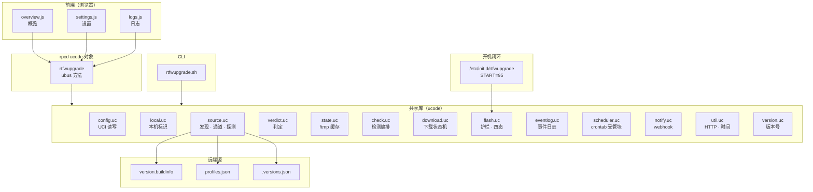
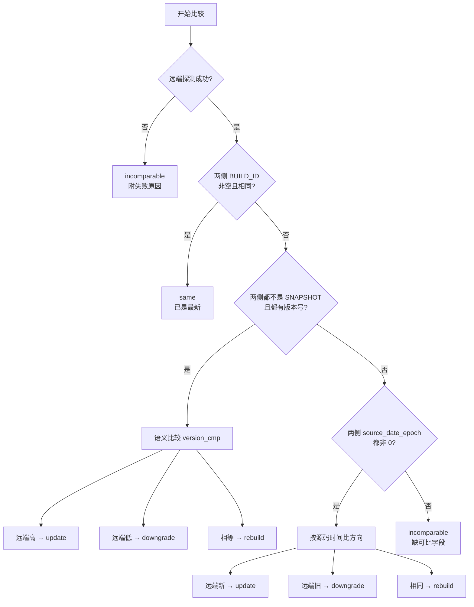
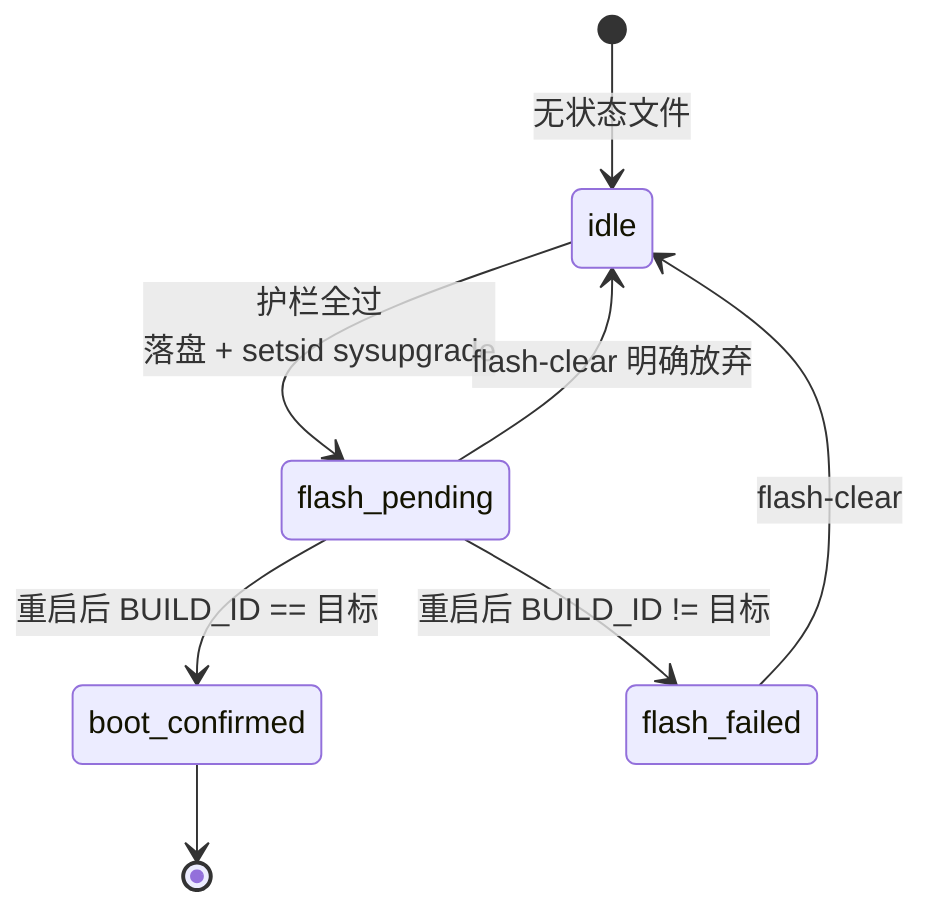

# 架构

## 组件



前端只经 rpcd ubus 对象访问后端（ACL：`ubus.rtfwupgrade.*` + `uci.rtfwupgrade`），
不在前端拼命令，也不给前端任意文件读写权限。

CLI（`/usr/bin/rtfwupgrade.sh`）与 rpcd 走**同一套库**，因此界面、cron、手工命令的
行为与日志口径一致 —— 不会出现「界面有记录、cron 没有」。

开机闭环另有一条不经过前端的路径：`/etc/init.d/rtfwupgrade`（START=95）→
`rtfwupgrade.sh flash-status --boot-check` → `flash.boot_check()`，结果回写
`/etc/rtfwupgrade.flash.json` 并投递刷写 webhook。

> [!NOTE]
>
> 未列入上图的两个辅助模块：`notify.uc`（webhook 投递，被 check/download/flash 调用）与
> `version.uc`（包版本号，供 `/usr/share/rpcd/ucode` 的 `version` 方法与前端陈旧检测使用）。

## 数据流（M1 检测）

1. `local.identity()` 读 `/usr/lib/os-release` 与 `/tmp/sysinfo/*` →
   `board_name`、`board_path`（`mediatek/filogic`）、`BUILD_ID`、`OPENWRT_BUILD_DATE`、`version_kind`。
2. `config.load()` 读 UCI，得到源列表与**唯一激活源**（`active_source` 失效时回退到列表第一条源）。
   同时读出 `current_firmware_source` —— 用户**认可过**的固件来源，与 `active_source` 是两个字段：
   前者只在「首次确认」与「放行跨源并真的刷写」时写入（见 `do_set_active` 的 `let first = ...`
   与 `do_flash` 里的强制刷写分支），后者每次换源都变。
3. `source.discover()` 取 `<base>/.versions.json`：成功则通道列表 = `snapshots` + 每个 `releases/<ver>`；
   失败则回退 `['snapshots']`；`default` 布局直接返回 `['current']`。
4. 通道解析分两层，都在 `source.uc`：
    - `resolve_channel(disc, local, want)`：把**语义值**翻成具体目录。`''`/`current` → 当前通道；
      `snapshot` → `snapshots`；`stable`/`oldstable` → `releases/<版本>`；`major`/`minor` →
      按本机版本线取最新；已是 `snapshots` 或 `releases/…` 的原样接受。解析不出就返回空串。
    - `resolve_for_probe()`：按**源上钉住的 channel + 命令行 override** 组合出最终通道；
      解析不出来时直接报错，**不回落**到别的通道 —— 回落会给出「来自你没选的通道」的结论。
      `dir_of(src, channel, local)` 再把它拼成完整 URL 目录（`official` 走 `<base>[/<system>]/<channel>/targets/…`，
      `default` 走 `<base>[/<system>]/targets/…`）。
      `channel_origin` 标明来源：`config`（用户钉住）/ `override`（`--channel`）/ `cache` /
      `.versions.json` / `default` / `layout`，界面在这一行后面加括号显示。
5. `source.probe()` 读 `version.buildinfo` 与 `profiles.json`，用 `supported_devices` 匹配 profile
   （回退：`board_name` 的 `,`→`_`），并从 `images[]` 里挑 `type=sysupgrade` + `filesystem=squashfs` 的候选。
6. `verdict.compare()` 先比身份（`BUILD_ID` vs `version.buildinfo`），再定方向
   （release 用 `version_number` 语义比较；snapshot 用 `source_date_epoch` ↔ `OPENWRT_BUILD_DATE`）。
7. `check.uc` 统一收口：结果写入 `/tmp/rtfwupgrade.last.json`，同时追加 `check` 事件；
   判定为 `update` / `rebuild` 或检测失败时投递检测 webhook。CLI 与 rpcd 都走这条路径，避免「界面有日志、cron 没有」。

## 判定状态

| state          | 含义               | 触发条件                           |
| -------------- | ------------------ | ---------------------------------- |
| `same`         | 已是最新           | 两侧构建标识相同                   |
| `update`       | 有可用更新         | 远端版本更高 / 远端源码更新        |
| `downgrade`    | 远端更旧（可降级） | 远端版本更低 / 远端源码更旧        |
| `rebuild`      | 同版本、不同构建   | 版本号或源码时间相同但构建标识不同 |
| `incomparable` | 无法比较           | 探测失败或缺少可比字段             |

判定严格按下列顺序，先命中先返回 —— 顺序本身就是优先级：



**明确不使用**：HTTP `Last-Modified`、文件 `mtime`、文件名里的日期。
这几项反映的是「发布时刻」而非「代码新旧」，见 `SOURCE-CONTRACT.md` 的反面教材。

## 自定义源

- 源 = UCI 段（`config source '<name>'`），由「设置」页的检测源表格**增删改**。
- 新建段必须声明类型：ucode 的 uci 模块里是 `ctx.set(CONFIG, name, 'source')`（三参形式）；
  用四参形式写 `type` 选项会返回 null（已实测）。
- 校验：标识 `^[a-z0-9][a-z0-9_-]{0,31}$`、地址必须 http(s)、布局白名单（`config.LAYOUTS` = `official` / `default`）。
- 布局语义：`official` 是 OpenWRT/ImmortalWRT 官方发布页结构（`root/releases/release/targets`，
  快照为 `root/snapshots/targets`）；`default` 是默认编译输出目录结构（`root/targets`）。
  旧配置里的布局别名只在 `config.uc` 的迁移映射里识别，新写入一律用新值。
- 删除激活源时，回退结果会**写实**回 UCI，避免留下悬空的 `active_source`；
  最后一条源不允许删除。
- **内置只有两个官方源**（`openwrt` / `immortalwrt`，即两个官方下载站），用于演示两种布局。
  聚合站与单版本发布站是设置页「预设」里的模板，只一键填表，**不会自动创建**。
- 判族（源属于哪个发行版）的三级依据，优先用最可靠的那个：
    1. `profiles.json` 的 `image_prefix`（构建系统自己写的前缀，最可信）；
    2. 镜像文件名前缀（`openwrt-` / `immortalwrt-`）；
    3. 源的 `system` 段与地址（退化手段，仅在前两级都取不到时才用）。
       判出的族与本机 `os-release` 的 `ID` 不一致时，探测结果附带**跨发行版警告**。
       三级的实现分别在 `distro_hint()` / `distro_from_image()` 里。

## 跨源与跨发行版：两套独立的判断

两者名字接近但判据、时机与作用都不同，不要混为一谈：

|      | 跨源更换（cross-source）                                       | 跨发行版刷写（cross-distribution）            |
| ---- | -------------------------------------------------------------- | --------------------------------------------- |
| 判据 | **`active_source` vs `current_firmware_source`（纯段名比较）** | 探测到的源所属族 vs **本机发行版**            |
| 时机 | 打开页面即可判断，**不需要先检测**                             | 每次检测后写入 `remote.warnings`              |
| 表现 | 概览页刷写区的红框 + 放行勾选；设置页换源对话框                | 刷写区的橙框 + `force` 勾选；8 条护栏里的 `f` |
| 后端 | `flash.uc` 的 `allow_cross_source()` 拦（h 条）                | `flash.uc` 的 `allow_cross()` 拦（f 条）      |
| 放行 | 只认当场 `force`，不吃持久默认                                 | `force` 或 `flash_allow_cross_distro`         |

**跨源判据只看两个 UCI 段名，不涉及发行版信息**。这两个字段的语义完全不同：

- `active_source`：此刻正在用的源，每次切换都变。
- `current_firmware_source`：用户**认可过**的固件来源，只在「首次确认」与
  「放行跨源并真的刷写」时更新（`do_set_active` 里 `let first = !length(...)` 决定）。

三种状态（`crossSourceState()`）：

| `current_firmware_source` | 与 `active_source` | 状态            | 界面行为                                        |
| ------------------------- | ------------------ | --------------- | ----------------------------------------------- |
| 空                        | —                  | `uninitialized` | 黄色引导块 + 三个操作（检测/下载/刷写）弹窗拦截 |
| 非空                      | 相同               | 无              | 正常                                            |
| 非空                      | 不同               | `switched`      | 红框 + 放行勾选，未勾选则阻断刷写               |

`uninitialized` 的弹窗**不是拒绝**，只是提醒「还没选定来源」；用户点「仍然继续」可放行，
本次会话内不再重复询问。这个提醒用回调而非返回 Promise —— 返回 Promise 会让按钮一直停在
加载态（用户取消后无人 resolve）。

- 概览页刷写区顺序固定为：判定分级提示 → 跨源更换 → 跨发行版刷写 → 此操作不可逆 →
  确认勾选 → 阻断清单 → 刷写按钮。越往下越接近不可逆动作。
- 跨发行版警告由 `probe()` 在检测时写入 `remote.warnings`，只有检测之后才有；
  跨源状态则在**打开页面时**就能算出来，两者时机不同，不能互相替代。
- 跨源拦截**两层都有**：界面层在 `flashLocalErrors()` 里列出「跨源尚未确认」并禁用刷写按钮；
  后端层是 `flash.uc` 的 h 条护栏。只做界面层不够 —— 直接调 ubus 或走 CLI（`--source`）
  都能绕过，而 CLI 正是无人值守与脚本最常用的入口。
  注意 `set_active` 这个 rpcd 方法**不做**跨源判断（换源不是刷写，换完不刷就没有风险），
  真正的闸在下一次刷写时。
- 后端两条护栏只认**一个** `force` 参数，没有区分来源。界面上的两个勾选框因此
  合并成一个 `force` 传给后端（`self.flashForce || self.crossSourceOk`），任一勾选即放行对应那条。

## 更新通道

- 通道**按源存放**（源的 `channel` 选项），不是全局开关：官方源有 `snapshots` 与多个
  `releases/<ver>`，单版本发布站（`default` 布局）只有一个目录，做成全局的会给出一个无效控件。
- 存的**不是某个补丁版本的目录**，而是「跟随哪条线」的语义值（`config.CHANNELS`）：
  `''` 当前通道、`snapshot` 快照版、`stable` 稳定版、`oldstable` 旧稳定版、
  `major` 当前主版本（如 25.x）、`minor` 当前子版本（如 25.12.x）。
  `source.resolve_channel()` 每次探测按源上 `.versions.json` 现算目录，所以选「稳定版」
  不会被钉在会过期的 25.12.2 上，而是跟着源前进。旧配置里直接写目录的值仍原样兼容。
- **判定策略不因通道改变**：通道只决定去哪个目录取数据，取回来之后一律走同一套
  `probe()` + `verdict.compare()`。选 stable 时得到 `downgrade` 是正确结果，不是缺陷。
- 语义值解析不出来时（源上没有这条线、或本机是 SNAPSHOT 无从解析主/子版本）
  `resolve_for_probe()` 直接报错，**绝不回落到别的通道** —— 回落会给出「来自你没选的通道」的结论。
- `default` 布局没有可选通道，恒为 `current`（`config.DEFAULT_CHANNEL`）：界面照常显示，
  但渲染成只读文本并标注「由布局固定」，`set_channel` 对它一律拒绝。
- 结果区标注**这份结果是哪个源产生的**（`res.source`，不是当前激活源）。两者不一致时
  额外给出警告：切换激活源会作废结果，但历史缓存或命令行 `--source` 都可能留下别的源的结论。
- **通道只在设置页改，概览页只读**。概览页展示当前通道与它的来源（`xxx (config)` /
  `xxx (.versions.json)` 等），想改就跳设置页 —— 概览页不再有切换控件与弹窗。
- 设置页改通道时弹窗说明三件事：上一次检测结果作废、跨通道构建不可比（可能出现「可降级」）、
  定时任务与自动刷写同样按这个通道走。确认后才写 UCI，并 `state.clear_last()`。
  切换**激活源**是另一件事，弹窗说明的是结果作废、新源构建序列可能不可比、定时任务跟随新源。
- rpcd `channels` 只读接口返回「这个源现有哪些通道」：优先复用上一次检测缓存的
  `channels`，没有缓存才现取 `.versions.json`（6 秒超时），避免开页面就多一次长网络往返。
- 编辑源时 `settings.js` 会把 `channel` 原样带回 `source_set`：该接口收到空值会删掉这个选项，
  否则改个名称就把钉住的通道弄丢了。

## 静态资源缓存

LuCI 把 `<script src="luci.js?v=...">` 中的版本戳作为 `resource_version` 追加到模块 URL。
本机这份 LuCI 没有该版本戳，模块与样式 URL 都是裸路径，响应里也没有 `Cache-Control`，
浏览器于是按 `Last-Modified` 的启发式规则缓存：包升级后仍会跑旧 JS，只能手动强制刷新。

本应用自己的样式表改由 `asset()` 拼上包版本号（`?v=<VERSION>`），版本一变 URL 就变。
JS 模块由 LuCI 的加载器负责，本包无法改写它的 URL，因此升级后若界面文案未更新，
强制刷新一次即可。

## i18n 与打包（对照官方）

- 结构对照 `feeds/luci/applications/luci-app-acl`：`Makefile` + `htdocs/` + `po/<lang>/<name>.po`。
- `luci.mk:326-351`：为 `po/` 下每个语言目录生成 `Package/luci-i18n-<basename>-<lang>`，
  其 install 步骤执行 `po2lmo <po> $(LUCI_LIBRARYDIR)/i18n/<name>.<lang>.lmo`
  （`LUCI_LIBRARYDIR` = `/usr/lib/lua/luci`）。
- 因此：**po 必须在包内**，语言包由构建产出；主包不携带 `.lmo`。
- 这套机制的构建前提是 `po2lmo`（由 `luci-base` 构建）→ 需要完整 feeds
  （`luci-base` 依赖 `liblua`，来自 packages feed）。CI 与 `tools/build-local.sh` 都按此配置。
- 设备侧开发流程不走 SDK：`tools/po2lmo.py`（po2lmo 的 Python 移植，哈希实现已用真实
  `base.zh-cn.lmo` 反查校验）在本地生成 lmo 后投到设备。

## 调度设置

- UCI：`schedule_kind`（off/daily/weekly/monthly）、`schedule_time`（24 小时制 `HH:MM`）、
  `schedule_weekday`（1=周一…7=周日）、`schedule_day`（1-28）。
- `config.schedule_cron()` 负责翻译成 5 段 cron，写 crontabs 直接用它：
  `daily 04:30 → 30 04 * * *`、`weekly 三 07:05 → 05 07 * * 3`、`monthly 15 23:59 → 59 23 15 * *`。
- 号数限制 1-28：29-31 号在部分月份不会触发，这个坑对"每月检查"是致命的。
- 校验在 `set_options` 里做（频率白名单、时间正则、星期 1-7、号数 1-28），非法即拒。

## 定时任务落地（M4）

- `scheduler.uc` 负责把调度写进 `/etc/crontabs/root` 的**受管标记块**：

    ```text
    # BEGIN rtfwupgrade (managed block, do not edit)
    0 4 * * * mkdir -p /tmp/rtfwupgrade && /usr/bin/rtfwupgrade.sh cron >> /tmp/rtfwupgrade/cron.log 2>&1
    # END rtfwupgrade
    ```

- 三条安全约定：**只动标记块**（块外的 nginx-util / acme 等原样保留）、写前备份到
  `<crontab>.rtfwupgrade.bak`、内容一致就不写文件也不重启 cron（幂等）。
- 旧版本遗留的标记块（旧应用名/旧 CLI 路径）在同步时先删除，再写入新块，避免同一份 crontab 里
  同时跑新旧两套命令。
- 触发点：`set_options` 成功后自动同步；`/etc/uci-defaults/80_rtfwupgrade` 在**首次启动**
  （S10boot 跑 uci-defaults）时同步一次：此时新配置仍为默认内容就把旧配置迁移到
  `/etc/config/rtfwupgrade`，已改过则保留新配置；卸载时清理自己的标记块。
  安装后若不重启，最长要等到下一次开机才会写入受管块，可手动跑
  `rtfwupgrade.sh schedule --apply`。
- 手动可用 `rtfwupgrade.sh schedule` 查看期望/实际 cron 行，`rtfwupgrade.sh schedule --apply` 写入。
- `rtfwupgrade.sh cron` 是定时入口：检测 → **记录 `check` 事件** → 档位 ≥1 且判定为 `update` / `rebuild` 时自动下载；
  档位 2 且判定为 `update`、镜像已 `verified` 时调 `flash.start({trigger:'auto'})` 继续刷写，
  成败都写 `warn`/`cron` 事件（`action` 为 `flash` 或 `flash-failed`）。
  `rebuild` 永远只下载不刷 —— 同版本不同构建刷下去得不到更新，只会白白重启一次设备。

## 事件日志

- `eventlog.uc` 往 `/tmp/rtfwupgrade/events.jsonl` 追加单行 JSON：`{ts, level, event, message, data?}`。
- `event` 目前有 `check` / `source` / `options` / `download` / `flash` / `cron`；`level` 为 `info|warn|error`。
  检测（无论来自 CLI、cron 还是 rpcd）、源增删改、设置保存、下载开始/结束/取消、
  刷写被阻断/发起/结案都会留痕。
- 超过 256 KB 时丢弃前半段做轮转（从换行处切，避免半行）。
- `logs` 方法返回最近事件 + `download.log` 尾部 + `cron.log` 尾部；`logs_clear` 清空事件与 `cron.log`
  （已下载的镜像不受影响）。
- 界面「日志」页只读展示；写日志的钩子在 `check.uc`、rpcd 插件与 `download.uc` 里。
- webhook：检测到 `update` / `rebuild` 时投递 `check_update`，检测失败投递 `check_failed`，
  下载收尾投递 `download_done`，刷写投递 `flash_started` / `flash_ok` / `flash_failed`
  （已是最新/远端更旧不打扰）；未配置 webhook 时静默跳过。

## 下载状态机（M2）

```text
idle ──download──▶ running ──(进程组退出)──▶ verified | failed
                     │
                     └──cancel──▶ cancelled ──download──▶ running（续传，resumed_from>0）
```

- 落盘：`/tmp/rtfwupgrade/<镜像名>`；状态：`download.json`；退出码：`download.rc`（后台命令写）。
- **收尾不依赖守护进程**：`status()` 发现进程组已退出就做体积/sha256 校验并投递 webhook，
  再写回状态；因此重启 rpcd 也不会丢状态机。
- **取消按进程组杀**（`kill -TERM -<pgid>`）：只杀组长会留下孤儿 curl 继续写文件（已实测踩坑）；
  `cleanup`（删除文件）同样会先杀进程组，否则 curl 会把删掉的文件重新写出来；它只删下载产物，
  保留 `events.jsonl` 与 `cron.log`（清日志是「日志」页的显式动作）。
- **续传保护**：只有 `ETag` **与** `Last-Modified` 都与上次一致才允许 `-C -`，否则删掉残片重下；
  判定原因写进 `resume_reason`，界面上能看到为什么没续传。
- 启动前会清扫残留下载进程，避免两个 curl 同时写同一个文件。
- `file_size_limits.image` 在**下载前**校验：镜像超过 profile 上限直接拒绝下载，
  而不是等到刷写前才检查（刷写前只剩体积对得上记录这一条护栏）。

## 状态与幂等

- 持久配置：`/etc/config/rtfwupgrade`。sysupgrade **默认就保留配置**
  （官方脚本 `export SAVE_CONFIG=1`，`-n` 才是关闭）；`-k` 的真实语义是把当前已安装包
  列表写进备份，`-c` 才额外保留 `/etc/` 下所有改动过的文件。本项目刷写固定用 `-c -k`。
- 运行态：`/tmp`（`rtfwupgrade.last.json`、`rtfwupgrade/download.json`、`flash.log`）；掉电即丢，天然幂等。
- **刷写状态是唯一放在 `/etc` 的运行态**：`/etc/rtfwupgrade.flash.json`。它必须跨过 sysupgrade 的
  重启，因此由包内的 `root/lib/upgrade/keep.d/rtfwupgrade` 登记（`root/` 前缀会被剥离，
  最终落到设备的 `/lib/upgrade/keep.d/rtfwupgrade`，与 `root/usr/share/luci/menu.d/` →
  `/usr/share/luci/menu.d/` 同构）；sysupgrade 只搬运 keep.d 里登记过的路径。
  反过来，`/tmp` 里的东西在刷写时一定丢，所以 `flash.log` 只用于事后排查，不参与判断。
- 四态与三条 webhook 事件见下节「刷写（M3）」；检测 webhook（`check_update` / `check_failed`）
  与下载完成 webhook（`download_done`）另在事件日志一节。

## 刷写（M3）

```text
idle ──flash──▶ flash-pending ──(重启后 BUILD_ID 比对)──▶ boot-confirmed | flash-failed
                    │
                    └──flash-clear（明确放弃）──▶ idle
```

### 四态，没有第五个

| state            | 含义                                                      |
| ---------------- | --------------------------------------------------------- |
| `idle`           | 没有状态文件                                              |
| `flash-pending`  | 已落盘、sysupgrade 已发起（重启前）                       |
| `boot-confirmed` | 重启后本机 `BUILD_ID` == 状态文件记录的目标构建           |
| `flash-failed`   | 重启后本机 `BUILD_ID` != 目标（或 sysupgrade 进程没起来） |



状态只前进不后退（除 `flash-clear` 显式清空）。`flash-pending` 期间再次刷写会被 `g` 条护栏挡住，
必须先重启让 `boot_check()` 结案，或明确放弃 —— 否则会出现「上一次结果未知却又发起新刷写」。

读取状态只有 `load_state()` 一个入口：文件被手改坏、JSON 解析失败或 `state` 不在四态里，
一律按 `idle` 处理，绝不把非法值漏给下游判断。13 个状态字段：`state` `trigger` `source` `channel` `file` `sha256`
`size` `target_build_id` `target_version` `previous_build_id` `started` `finished` `error`。

### 命令形态：`sysupgrade -c -k <绝对路径>`

- **不加 `-n`**：保留配置本来就是默认（官方脚本 `export SAVE_CONFIG=1`），`-n` 才是关闭。
- `-k` 把当前已安装包列表写进备份，`-c` 额外保留 `/etc/` 下所有改动过的文件。
- 路径必须是绝对路径且经过 `shquote`；镜像名在 `download.uc` 里已被压成 `[A-Za-z0-9._-]`。
- `sysupgrade` 末尾走 `ubus call system sysupgrade`，**命令不会返回**，设备直接重启。
  因此只能 `setsid` 后台起、输出重定向进 `/tmp/rtfwupgrade/flash.log`，绝不能同步等待。

### 八条阻断护栏（全部阻断，不是警告）

顺序固定 a→h（h 排在 f 之后、g 之前），全部在 `guards()` 里，`start()` 复用同一份判定（不重复拉 `profiles.json`）：

| #   | 条件                                                                        | 挡住的问题                                   |
| --- | --------------------------------------------------------------------------- | -------------------------------------------- |
| a   | 下载状态 != `verified`                                                      | 镜像没下完或校验没过                         |
| b   | `verified != true` 或 `sha256` 为空                                         | 没有可比对的校验依据                         |
| c   | 记录的 `file` 非绝对路径 / 体积未知 / 实际体积 != 记录体积                  | 文件被换掉、截断或不在了                     |
| d   | `verdict` 不是 `update` 也不是 `rebuild`                                    | 不该为一次没有依据的刷写重启设备             |
| e   | probe 失败 / `image` 为 null / `type!=sysupgrade` 或 `filesystem!=squashfs` | factory 类镜像会重写引导链或分区表，刷了变砖 |
| f   | `probe.warnings` 含「跨发行版」且 `!allow_cross()`                          | 换系统不是升级，配置极可能不兼容             |
| h   | 本次要用的源 != `current_firmware_source` 且 `!allow_cross_source()`        | 从用户没确认过的来源刷写（跨源更换）         |
| g   | 状态文件仍是 `flash-pending`（未结案）                                      | 上一笔刷写没确认，此刻没有任何可信基线       |

另有**两条不阻断的提示**：判定是 `rebuild`（只下载不刷）、远端 `source_date_epoch` 较旧。

两条放行判据刻意分开，因为它们是两种不同的「同意」：

- `allow_cross()`（f 条，跨发行版）：`force` 参数 **或** 手工路径的持久默认 `flash_allow_cross_distro`。
- `allow_cross_source()`（h 条，跨源）：**只认当场 `force`**，不吃 `flash_allow_cross_distro` ——
  那个开关的语义是「我接受换发行版」，让它顺手放行跨源，等于一次勾选悄悄替用户确认了一个
  他从没确认过的固件来源。

两者都遵循同一条铁律：**自动路径（`trigger=auto`）永远返回 false**，连显式 `force` 都忽略 ——
定时任务不该把设备刷成另一个发行版，也不该从用户没认可的来源刷写。
界面上跨源与跨发行版是两个勾选框，但传给后端的是**同一个** `force`：任一勾选即放行对应那条。

首次使用（`current_firmware_source` 为空）不算跨源：那只是还没初始化，由概览页引导确认，
不该让全新安装的 CLI 立刻不可用。

### 顺序铁律：先落盘，后刷写

`start()` 的第一步是 `save_state(flash-pending)`，**落盘失败就直接 return false，绝不刷写**。
理由：`fs.writefile` 写失败时返回 null 而不一定抛异常（真机实测 `/proc` 下即如此），
若先刷再记，设备恰好在这两步之间断电重启，就再也没人知道这次刷写发生过 —— 下次开机无从判断。
反过来，`sysupgrade` 进程没起来（`pid<=0`）时会把刚写的 pending 改判 `flash-failed` 并盖 `finished`，
不留一个永远等不到重启的 pending。

### 开机闭环为什么挂在 init.d 而不是 uci-defaults

`/etc/init.d/rtfwupgrade`（`START=95`，排在 network/procd 之后）在 `start()` 里调用
`/usr/bin/rtfwupgrade.sh flash-status --boot-check`。不能放进 `80_rtfwupgrade` 的原因：
**uci-defaults 是一次性的** —— `/etc/init.d/boot` 的 `uci_apply_defaults` 在脚本成功返回后
立刻 `rm -f` 掉已应用的文件，第二次开机它根本不会被调用。而「刷写后重启」每次都要再判一次。

`boot_check()` 只在状态为 `flash-pending` 时动作：非 pending 直接返回 `changed:false` 且**不改文件**；
`BUILD_ID` 相同 → `boot-confirmed`，不同 → `flash-failed`，**两支都回写并盖 `finished`**，
保证下次开机不重复上报（webhook 也只投递一次）。开机时不去探测远端，只用状态文件里的记录拼最小负载。

### 失败为什么不自动回滚

刷写失败（重启后构建标识没变）意味着**设备还活着、旧系统还在跑**，此时：

1. 状态文件里留着完整的记录（`file` / `sha256` / `target_build_id` / `error`），界面与 `flash-status`
   能直接说清哪一步没成，比自动再刷一次更好排查；
2. 自动重刷会把「一次性失败」变成「重启循环」，而重复失败的最常见原因（镜像不匹配、跨发行版、
   存储异常）恰恰不会因为再刷一次而消失；
3. 回滚需要一份「已知可用」的镜像，而本应用只下载、从不保存上一版固件，没有可信的回滚目标。

所以失败一律停在 `flash-failed`，由人判断（界面有「清除状态」，CLI 是 `flash-clear`）。

### 刷写类 webhook

`flash_started`（发起时）、`flash_ok` / `flash_failed`（开机闭环结案时），未配置 webhook 静默跳过。

## 不做的事

- 不使用 HTTP `Last-Modified`、文件 mtime、文件名里的日期作为更新判据（原因见 `SOURCE-CONTRACT.md`）。
- **不做自动回滚**：刷写失败停在 `flash-failed`，由人决定下一步（理由见上节）。
- **不刷非 squashfs 的 sysupgrade 镜像**：factory / 其它类型会重写引导链或分区表，一律由护栏 e 阻断。
- **不做「无条件自动刷写」**：档位 2 也只在判定为 `update` 且八条护栏全过时才刷。
- 不碰原生 `view/system/flash.js`，不接管系统刷写入口。
